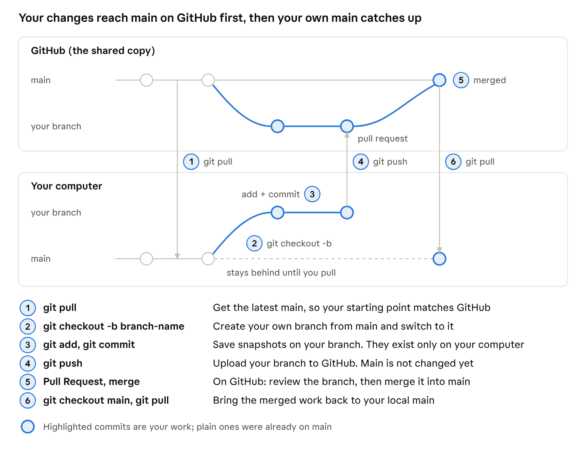

# Git & GitHub Quick Guide for Our Group Project

This guide covers everything you need to know about git and GitHub for our project. You will do the same 8 steps every time you work on the site. After a couple of rounds it becomes automatic.
## The big idea
- Git is a version control tool on your computer that saves snapshots of our code and tracks who changed what. It can be used for any type of file.
- GitHub is the website that stores our shared copy (the repository, or repo).
- The `main` branch is the finished, working version of the website. We never edit it directly.
- A branch is your own private copy of the project to work in. When your work is ready, you ask for it to be added to main with a Pull Request (PR).
Think of it like Google Docs suggestions: you make your changes on the side, someone checks them, then they get merged in.
## Add, commit and push: what each one does
These three commands are how your work travels from your editor to GitHub. Think of posting a parcel: git add puts items in the box, git commit seals and labels the box, and git push posts it.

| Command | What it does | Who can see the result |
| ------- | ------------ | ---------------------- |
| `git add` | Chooses which changed files go into your next snapshot | Only you |
| `git commit` | Saves the snapshot, with a message, on your computer | Only you |
| `git push` | Uploads your commits to GitHub | The whole team |

### git add: choose what goes in the snapshot
Saving a file in VS Code does not tell Git about it. `git add` does. You can add files one at a time, several at once, or everything you changed:
```
git add about.html
git add css/style.css js/main.js
git add .
```

The `.` means "everything in this folder". Adding is useful because you can leave out files that are not ready yet. `Run git status` afterwards: staged files are shown in green.

### git commit: save the snapshot
A commit saves everything you added as one snapshot, with a message describing it. It stays on your computer until you push.
```git commit -m "Add team photos section to about page"```
The text in quotes is your commit message. Make it a short sentence about what you did. You can add and commit several times on the same branch, and each commit is one more snapshot in the history.

### git push: send your commits to GitHub
Pushing uploads your commits so the rest of the team can see them. Until you push, nobody else has your work, and if your laptop broke you would lose it.
```
git push
```
A typical session looks like this:
```
git add about.html css/style.css
git commit -m "Add team photos section to about page"
git push
```
Pushing sends your branch only. It does not change main. That happens later, when your Pull Request is merged.

## Branches: how your work reaches main
A branch is your own line of commits, started from main. Nothing you do on it changes main until a Pull Request is merged. The diagram follows one branch from start to finish, on GitHub and on your computer.

There are two copies of the project: the shared one on GitHub (called `origin`) and the one on your computer. Each has its own `main`, and they only match after you run `git pull`.
- Before the merge: `main` on GitHub does not change, however many times you push. If you push more commits to your branch, the open Pull Request updates itself.
- After the merge: GitHub's `main` has your work, but your local `main` is still behind. Run `git checkout main` then `git pull` to catch up.
- Tidy up: GitHub offers a Delete branch button once the PR is merged. On your computer, remove the old branch with `git branch -d sam-contact-page`. Then start your next task with a fresh branch from the latest `main`.

## One-time setup
Do this once, then never again.
1.  Install Git from `git-scm.com` (accept the default options). Also install VS Code if you do not have an editor yet.
2.  Open a terminal. On Windows use Git Bash (installed with Git). On Mac use Terminal. In VS Code you can use Terminal > New Terminal.
3.  Tell Git who you are. Use the same name and email as your GitHub account, because this is how your contributions are credited:
```
git config --global user.name "Your Name"
git config --global user.email "you@example.com"
```
Then run this second setting. It tells Git to create your branch on GitHub automatically the first time you push it (step 7 explains what is happening):
```
git config --global push.autoSetupRemote true
```
4.  Download (clone) the project. Copy the repo URL from the green Code button on GitHub, then:
```
cd Documents
git clone PASTE-THE-URL-HERE
cd the-repo-folder-name
```
Alternatively if you want to name the folder locally something different:
```
cd FOLDER-YOU-WANT-TO-USE
git clone PASTE-THE-URL-HERE .
```
Adding the `.` at the end tells git to unpack the git repo in the current place rather than create a folder for it.
You now have the project on your computer. Open that folder in VS Code.

## The 8 steps (every time you work)

1. Go to main and get the latest version
```
git checkout main
git pull
```
This makes sure you start from everyone else's most recent work.

2. Create your own branch
Give it a short name that says what you are doing, with your name in it:
```
git checkout -b sam-contact-page
```
The `-b` means "create a new branch". Check which branch you are on any time with `git branch` (the one with a star is current).

3. Make your changes
Edit files in VS Code and save them as normal. Try to keep each branch to one small job (for example "build the contact form"), not a whole week of work.

4. Check what you changed
```
git status
```
This lists the files you edited. Red means changed but not yet staged. Green means staged and ready to commit.

5. Stage your files
Staging means "pick the changes I want in my next snapshot".
```
git add contact.html css/contact.css
```
Or to stage everything you changed:
```
git add .
```
Run `git status` again. Your files should now be green.

6. Commit with a message
A commit is the snapshot. The message says what you did, in plain English:
```
git commit -m "Add contact form with name, email and message fields"
```
Good messages start with a verb and are specific: "Add navbar to about page", "Fix broken image link on home page". Avoid "stuff" or "changes". You can make several commits on one branch. Small, frequent commits are better than one huge one.

7. Push your branch to GitHub
Upload your branch to GitHub:
```
git push
```
What is happening behind the scenes: your new branch only exists on your computer until you push it. GitHub's copy of the project is called `origin`, and the first push creates your branch there and links the two together. Without the setting from the one-time setup, you would have to spell that out each time with `git push -u origin your-branch-name`. With it, plain `git push` does the same thing.

8. Open a Pull Request
1.  Go to the repo on GitHub. You will see a yellow banner: Compare & pull request. Click it.
2.  Write a short title and one or two sentences about what you did.
3.  Click Create pull request.
4.  Tell the team in our group chat so someone can review it.
Once a teammate approves, the PR is merged into main. Click Merge pull request (or ask Matt to).

## After your PR is merged
Go back to step 1 to start your next piece of work:
```
git checkout main
git pull
git checkout -b your-next-branch-name
```

## Quick cheat sheet
| What you want | Command |
| ------------- | ------- |
|Download the project (once) | `git clone URL` |
| See what branch you are on | `git branch` |
| Switch to main | `git checkout main` |
| Get latest changes | `git pull` |
| Create a new branch | `git checkout -b branch-name` |
 See what you changed | `git status` |
| Stage everything | `git add .` |
| Save a snapshot | `git commit -m "message"` |
| Upload your branch | `git push` |

## Team rules
1.  Never work directly on main. Always make a branch first.
2.  Always `git pull` on main before making a new branch.
3.  One branch per task, and keep tasks small.
4.  Write a clear commit message every time. This is also how your contribution gets recorded for the project.
5.  If you are stuck, ask. It is much easier to fix a git problem early than after an hour of work.

## When things go wrong
"I made changes but I'm on main!" Don't panic and don't commit. Run `git checkout -b my-new-branch`. Your changes come with you onto the new branch, and you can continue from step 4.
`git push` says the branch has no upstream. The one-time setting is missing. Run `git config --global push.autoSetupRemote true`, then `git push` again. Alternatively, use the full command `git push -u origin your-branch-name`.
Merge conflict. This happens when two people edit the same lines of the same file. Git marks the file with `<<<<<<<` and `>>>>>>>` lines. Do not try to fix it alone. Message the group, and we will sort it out together. You can avoid most conflicts by pulling main often and keeping branches small.
You want to throw away changes in one file (before staging). `git restore filename`. Be careful: this cannot be undone.
"fatal: not a git repository". You are in the wrong folder in the terminal. Use cd to go into the project folder.

## How our contributions are recorded
GitHub tracks contributions automatically, as long as your commits use your own name and email (see setup step 4):
- Pull Requests tab: every PR shows who opened it and what changed.
- Insights > Contributors: a graph of commits per person.
- Commit history: in a terminal, git log --author="Your Name" lists your commits.

So: commit often, write clear messages, and do your work through PRs.
